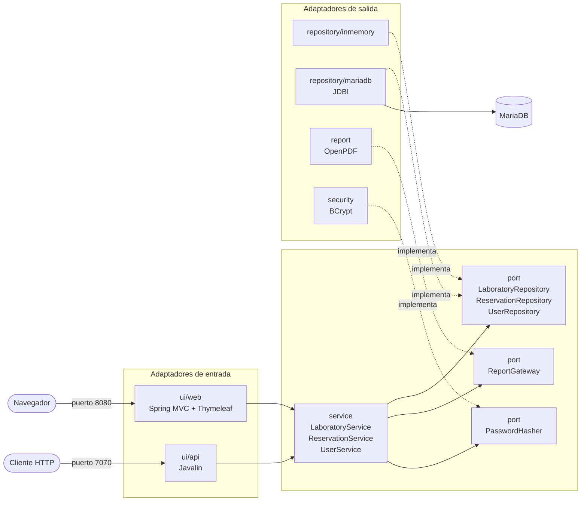

# LabSlot

<div align="center">

[](https://openjdk.org/projects/jdk/17/)
[](https://spring.io/projects/spring-boot)
[](https://gradle.org/)
[](https://mariadb.org/)
[](https://jdbi.org/)
[](https://javalin.io/)
[](https://junit.org/)

</div>

Proyecto integrador de **Desarrollo Orientado a Servicios 2026-2**, Universidad Santo Tomás, Seccional Tunja.

## Propuesta

1. **Problema:** los laboratorios de la universidad se reservan por correo o en papel, y dos grupos terminan con el mismo laboratorio a la misma hora.
2. **A quién le sirve:** a los estudiantes y docentes que solicitan reservas, y al administrador que gestiona los laboratorios y aprueba o rechaza las solicitudes.
3. **Qué datos guarda y consulta:** los laboratorios, las reservas por franjas horarias y los usuarios con su rol.

## Inicio rápido

1. Instala **JDK 17** y **MariaDB**, y deja MariaDB corriendo ([requisitos](#requisitos)).
2. Crea la base y el usuario `labslot` ([preparar la base de datos](#preparar-la-base-de-datos)).
3. Clona el proyecto y entra en su carpeta:
   ```bash
   git clone https://github.com/jseb-cruz/labslot.git
   cd labslot
   ```
4. Define la contraseña de la base y arranca la aplicación:
   ```bash
   export DB_PASSWORD='TuContraseña'
   ./gradlew bootRun
   ```
5. Abre <http://localhost:8080> y entra como administrador: `admin@usantoto.edu.co` / `Admin2026*`. Crea un laboratorio en **Laboratorios** y un usuario en **Usuarios**; con ese usuario ya se pueden hacer reservas ([usuarios y roles](#usuarios-y-roles)).

**¿Sin MariaDB?** Salta los pasos de la base y arranca en modo memoria: `LABSLOT_REPOSITORY=inmemory ./gradlew bootRun`

**¿Necesitas datos para una demostración?** Mira [datos de demostración](#datos-de-demostración).

## Funcionalidades

- Solicitud de reservas por franja horaria, sin cruces de horario.
- Aprobación, rechazo, cancelación y finalización de reservas.
- Gestión de laboratorios: listar, crear y alternar entre activo y mantenimiento.
- Gestión de usuarios para el administrador: listar, crear y eliminar.
- Inicio de sesión con dos roles: administrador y usuario.
- Páginas de error propias (403, 404 y 500).
- API REST en JSON con los mismos usuarios y las mismas reglas de la web.
- Reporte de reservas en PDF, descargable desde la web.
- Dos formas de guardar los datos: MariaDB o memoria.

## Tecnologías

| Parte | Tecnología |
|---|---|
| Lenguaje y construcción | Java 17, Gradle con Kotlin DSL |
| Aplicación | Spring Boot 4.1.2 |
| Web | Spring MVC, Thymeleaf, Spring Security, Bootstrap |
| API REST | Javalin 7.2.2 |
| Persistencia | JDBI 3.55.0 sobre MariaDB |
| Reportes | OpenPDF 2.0.5 |
| Tests | JUnit 5 |

## Arquitectura hexagonal

### Árbol de paquetes

```text
labslot/
├── src/
│   ├── main/
│   │   ├── java/dev/team/labslot/
│   │   │   ├── Application.java
│   │   │   ├── core/
│   │   │   │   ├── constant/      Constants, LaboratoryState, ReservationState, UserRole
│   │   │   │   ├── dto/           LaboratoryDTO, ReservationDTO, UserDTO
│   │   │   │   ├── entity/        Laboratory, Reservation, User
│   │   │   │   ├── port/          LaboratoryRepository, ReservationRepository, UserRepository,
│   │   │   │   │                  ReportGateway, PasswordHasher
│   │   │   │   └── service/       LaboratoryService, ReservationService, UserService
│   │   │   └── adapter/
│   │   │       ├── report/        OpenPdfReportGateway
│   │   │       ├── security/      BCryptPasswordHasher
│   │   │       ├── repository/
│   │   │       │   ├── inmemory/  InMemoryConfig, InMemoryLaboratoryRepository,
│   │   │       │   │              InMemoryReservationRepository, InMemoryUserRepository
│   │   │       │   └── mariadb/   MariaDbConfig, MariaDbLaboratoryRepository,
│   │   │       │       │          MariaDbReservationRepository, MariaDbUserRepository
│   │   │       │       ├── entity/        LaboratoryJdbi, ReservationJdbi, UserJdbi
│   │   │       │       └── repositories/  LaboratoryDao, ReservationDao, UserDao
│   │   │       └── ui/
│   │   │           ├── api/       JavalinServer, LaboratoryRestController, ReservationRestController
│   │   │           └── web/       HomeController, ReservationController, AdminReservationController,
│   │   │                          LaboratoryController, UserController, SecurityConfig,
│   │   │                          WebControllerAdvice
│   │   └── resources/
│   │       ├── application.properties
│   │       ├── schema.sql
│   │       ├── data.sql               administrador general (se carga solo)
│   │       ├── demo-data.sql          datos de demostración (se carga a mano)
│   │       ├── static/            Bootstrap (CSS y JavaScript)
│   │       └── templates/         vistas Thymeleaf y páginas de error
│   └── test/java/dev/team/labslot/core/
│       ├── entity/                LaboratoryTest, ReservationTest, UserTest
│       └── service/               ServiceBusinessRulesTest
├── gradle/wrapper/
├── build.gradle.kts
├── settings.gradle.kts
├── gradlew
├── gradlew.bat
├── .gitattributes
├── .gitignore
└── README.md
```

### Qué hay en cada capa

| Capa | Paquete | Responsabilidad |
|---|---|---|
| Dominio | `core/entity`, `core/constant` | Entidades que validan sus datos al construirse, estados, roles y límites |
| Datos de entrada | `core/dto` | Datos para crear o actualizar, sin ids |
| Puertos | `core/port` | Interfaces de lo que el dominio necesita del exterior: guardar datos, generar reportes y cifrar contraseñas |
| Servicios | `core/service` | Casos de uso y reglas de negocio |
| Adaptadores de entrada | `adapter/ui/web`, `adapter/ui/api` | Reciben las peticiones de la web y de la API, y llaman a los servicios |
| Adaptadores de salida | `adapter/repository/*`, `adapter/report`, `adapter/security` | Implementan los puertos: memoria, MariaDB, PDF y BCrypt |
| Configuración | `InMemoryConfig`, `MariaDbConfig` | Crean los repositorios y los servicios; `labslot.repository` elige cuál se usa |

### Regla de dependencias

Las dependencias van siempre **de `adapter` hacia `core`**. El paquete `core` no importa nada de `adapter`, de Spring, de Javalin, de JDBI ni de OpenPDF: solo Java. Por eso se puede cambiar MariaDB por memoria, o agregar la API, sin modificar las reglas de negocio.

### Diagrama



## Dominio y reglas de negocio

### Entidades y enums

| Entidad | Datos |
|---|---|
| `Laboratory` | `laboratoryId`, `code`, `name`, `building`, `capacity`, `state` |
| `Reservation` | `reservationId`, `laboratoryId`, `userId`, `date`, `startTime`, `endTime`, `attendees`, `purpose`, `state`, `createdAt` |
| `User` | `userId`, `fullName`, `email`, `password`, `role` |

- `LaboratoryState`: `LSTATE_ACTIVE`, `LSTATE_MAINTENANCE`
- `ReservationState`: `RSTATE_PENDING`, `RSTATE_APPROVED`, `RSTATE_REJECTED`, `RSTATE_CANCELLED`, `RSTATE_COMPLETED`
- `UserRole`: `ROLE_ADMIN`, `ROLE_USER`

### Reglas de las reservas

- El laboratorio y el usuario deben existir, y el laboratorio debe estar activo.
- Los asistentes deben ser más de cero y no superar la capacidad del laboratorio. Llenarlo exactamente sí se permite.
- El propósito es obligatorio y tiene máximo 255 caracteres.
- La hora de fin debe ser posterior a la de inicio.
- La franja debe estar entre las 06:00 y las 22:00, ambas incluidas.
- La duración máxima es de 4 horas. Exactamente 4 horas sí se permite.
- No se reserva en una fecha pasada, ni hoy en una hora que ya pasó (hora de Colombia).
- No puede cruzarse con otra reserva pendiente o aprobada del mismo laboratorio el mismo día. Dos reservas seguidas (10:00–12:00 y 12:00–14:00) no se cruzan.
- Toda reserva nueva queda pendiente.
- Un usuario solo cancela sus propias reservas; el administrador cancela cualquiera.

Además, el código de un laboratorio es único, sin distinguir mayúsculas.

### Reglas de los usuarios

- El correo es único, sin distinguir mayúsculas, y debe tener un formato válido.
- El nombre y el correo tienen máximo 150 caracteres.
- La contraseña tiene mínimo 8 caracteres y máximo 72 (las tildes y la ñ cuentan doble, por el límite de BCrypt).
- La contraseña se guarda como hash BCrypt, nunca en texto plano.
- No se puede eliminar un usuario con reservas, en cualquier estado.
- Un administrador no puede eliminar su propio usuario, así siempre queda al menos uno.

### Cambios de estado

| Acción | Desde | Queda en |
|---|---|---|
| Aprobar | Pendiente | Aprobada |
| Rechazar | Pendiente | Rechazada |
| Cancelar | Pendiente o aprobada | Cancelada |
| Completar | Aprobada | Completada |

## Puesta en marcha

### Requisitos

- **JDK 17.** Debe estar instalado aunque uses otra versión por defecto: Gradle lo busca para compilar y ejecutar, y el proyecto no lo descarga.
- **MariaDB** en `localhost:3306`. No hace falta en modo `inmemory`.
- Gradle no se instala: se usa el wrapper `./gradlew` incluido.

Arch / EndeavourOS:

```bash
sudo pacman -S jdk17-openjdk mariadb
sudo mariadb-install-db --user=mysql --basedir=/usr --datadir=/var/lib/mysql
sudo systemctl start mariadb
```

Ubuntu / Debian (el paquete `openjdk-17-jdk` depende de la versión del sistema):

```bash
sudo apt update
sudo apt install openjdk-17-jdk mariadb-server
sudo systemctl start mariadb
```

`systemctl start` inicia MariaDB solo hasta que apagues el equipo. Para que arranque siempre con el sistema: `sudo systemctl enable mariadb`.

### Clonar

```bash
git clone https://github.com/jseb-cruz/labslot.git
cd labslot
```

### Preparar la base de datos

Entra en MariaDB como administrador:

```bash
sudo mariadb
```

Crea la base y el usuario, cambiando `TuContraseña` por la tuya:

```sql
CREATE DATABASE labslot CHARACTER SET utf8mb4 COLLATE utf8mb4_unicode_ci;
CREATE USER 'labslot'@'localhost' IDENTIFIED BY 'TuContraseña';
GRANT ALL PRIVILEGES ON labslot.* TO 'labslot'@'localhost';
EXIT;
```

Con `EXIT;` se sale de MariaDB y se vuelve a la terminal.

Las tablas y el administrador general **se crean solos** al arrancar la aplicación: `schema.sql` crea las tablas que falten y `data.sql` inserta el administrador. Los laboratorios y las reservas empiezan vacíos. Los arranques siguientes no borran ni duplican nada.

### Configurar la contraseña

La contraseña no está en el proyecto: se lee de la variable de entorno `DB_PASSWORD`.

**En la terminal** (dura hasta cerrar esa terminal):

```bash
export DB_PASSWORD='TuContraseña'
```

Para que no quede en el historial de la terminal, se puede escribir sin mostrarla (bash o zsh):

```bash
read -rs DB_PASSWORD && export DB_PASSWORD
```

**En IntelliJ IDEA:**

1. *Run → Edit Configurations* y elige la configuración de `Application`.
2. *Modify options → Environment variables* y escribe `DB_PASSWORD=TuContraseña`.
3. No marques *Store as project file*, para que la contraseña no termine en el repositorio.

### Ejecutar

Desde la terminal:

```bash
./gradlew bootRun
```

Desde IntelliJ IDEA, ejecuta la clase `dev.team.labslot.Application`.

| Servicio | Dirección |
|---|---|
| Web | <http://localhost:8080> |
| API REST | <http://localhost:7070/api> |

### Modos de almacenamiento

La propiedad `labslot.repository` elige dónde se guardan los datos:

| Modo | Para qué sirve | Datos |
|---|---|---|
| `mariadb` (por defecto) | Uso normal: los datos se conservan al reiniciar | `schema.sql` y `data.sql` |
| `inmemory` | Probar o mostrar el proyecto sin base de datos | Solo el administrador general, creado en cada arranque; todo se pierde al cerrar |

Para usar el modo `inmemory` sin cambiar archivos:

```bash
LABSLOT_REPOSITORY=inmemory ./gradlew bootRun
```

En IntelliJ IDEA, agrega `LABSLOT_REPOSITORY=inmemory` a las variables de entorno. En este modo no hacen falta MariaDB ni `DB_PASSWORD`.

## Errores comunes al arrancar

Si algo falla con la base, la aplicación se detiene al arrancar. Busca estas líneas `Caused by` al final del error:

| Mensaje | Causa | Solución |
|---|---|---|
| `Socket fail to connect to localhost:3306` y `Conexión rehusada` (o `Connection refused`) | MariaDB está apagada | `sudo systemctl start mariadb` |
| `Access denied for user 'labslot'@'localhost' (using password: NO)` | `DB_PASSWORD` no está definida | Definirla en la misma terminal o en la configuración de IntelliJ |
| `Access denied for user 'labslot'@'localhost' (using password: YES)` | La contraseña es incorrecta o el usuario `labslot` no existe | Corregir `DB_PASSWORD` o revisar [la preparación de la base](#preparar-la-base-de-datos) |

## Datos de demostración

`src/main/resources/demo-data.sql` tiene 4 usuarios, 5 laboratorios y 14 reservas en distintos estados. **No se carga solo** y sirve únicamente en modo `mariadb`.

Arranca la aplicación al menos una vez, para que existan las tablas, y desde la carpeta del proyecto ejecuta:

```bash
mariadb -h localhost -u labslot -p --default-character-set=utf8mb4 labslot < src/main/resources/demo-data.sql
```

Pide la contraseña del usuario `labslot`. Cargarlo dos veces no duplica datos. Estos son sus usuarios:

| Nombre | Correo | Contraseña | Rol |
|---|---|---|---|
| Martha Lucía Vargas Rojas | `martha.vargas@usantoto.edu.co` | `Admin2026*` | Administrador |
| Jorge Andrés Castro Pinzón | `jorge.castro@usantoto.edu.co` | `Usta2026*` | Usuario |
| Valentina Suárez Niño | `valentina.suarez@usantoto.edu.co` | `Usta2026*` | Usuario |
| Daniel Felipe Rincón Ávila | `daniel.rincon@usantoto.edu.co` | `Usta2026*` | Usuario |

Las fechas de las reservas se calculan **el día en que se carga** y después no se mueven, así que conviene cargarlo el mismo día de la demostración. Para recalcularlas, vacía las reservas y vuelve a cargarlo:

```bash
mariadb -h localhost -u labslot -p labslot -e "DELETE FROM reservations;"
```

Para volver a empezar solo con el administrador general, detén la aplicación, vacía las tres tablas y arráncala de nuevo:

```bash
mariadb -h localhost -u labslot -p labslot -e "DELETE FROM reservations; DELETE FROM laboratories; DELETE FROM users;"
```

> **Advertencia:** estos dos comandos no se pueden deshacer y borran también los datos que hayas creado tú en esas tablas.

## Usuarios y roles

La aplicación empieza con un solo usuario:

| Nombre | Correo | Contraseña | Rol |
|---|---|---|---|
| Administrador General | `admin@usantoto.edu.co` | `Admin2026*` | Administrador |

Los demás usuarios los crea el administrador desde la web, en **Usuarios** (<http://localhost:8080/admin/users>), donde también puede eliminar los que no tengan reservas. La lista muestra nombre, correo y rol, nunca la contraseña. Si se elimina a un usuario con la sesión abierta, su siguiente petición lo lleva al inicio de sesión. Las contraseñas no se guardan en texto plano, sino como hashes BCrypt.

> **Importante:** la contraseña del administrador general es conocida, porque está publicada aquí. En un uso real hay que reemplazarlo. La aplicación no tiene una pantalla para cambiar contraseñas, así que, en modo `mariadb`, se hace de esta forma:
>
> 1. Entra con el administrador general y crea en **Usuarios** otro administrador, con una contraseña propia.
> 2. Entra con el nuevo administrador y elimina al administrador general.
> 3. Cambia `spring.sql.init.mode` de `always` a `never` en `application.properties` (la primera de las dos líneas). Si no, `data.sql` vuelve a crear al administrador general en el siguiente arranque.

| Acción | Usuario | Administrador |
|---|---|---|
| Ver reservas | Web y API, solo las suyas | Web y API, todas, con filtro por estado |
| Filtrar sus reservas por estado | API | – |
| Crear reservas | Web y API | No |
| Cancelar reservas | Web y API, solo las suyas | Web y API, cualquiera |
| Aprobar, rechazar y completar | No | Web y API |
| Consultar laboratorios | API; en la web, los activos al crear una reserva | Web y API |
| Crear laboratorios y cambiar su estado | No | Web y API |
| Ver, crear y eliminar usuarios | No | Web |
| Descargar el reporte PDF | No | Web |

## API REST

Escucha en el puerto **7070**, recibe y devuelve JSON, y usa autenticación **HTTP Basic** con los mismos usuarios de la web. Ninguna respuesta incluye contraseñas.

### Endpoints

| Método | Ruta | Rol | Respuesta |
|---|---|---|---|
| GET | `/api/laboratories` | Usuario, Administrador | 200, lista de laboratorios |
| GET | `/api/laboratories/{laboratoryId}` | Usuario, Administrador | 200, un laboratorio |
| POST | `/api/laboratories` | Administrador | 201, el laboratorio creado |
| POST | `/api/laboratories/{laboratoryId}/toggle-state` | Administrador | 200, el laboratorio con el nuevo estado |
| GET | `/api/reservations` (opcional `?state=`) | Usuario, Administrador | 200, lista de reservas: el usuario solo ve las suyas |
| GET | `/api/reservations/{reservationId}` | Usuario, Administrador | 200, una reserva: el usuario solo puede ver las suyas |
| POST | `/api/laboratories/{laboratoryId}/reservations` | Usuario | 201, la reserva creada, pendiente |
| POST | `/api/reservations/{reservationId}/approve` | Administrador | 200, la reserva aprobada |
| POST | `/api/reservations/{reservationId}/reject` | Administrador | 200, la reserva rechazada |
| POST | `/api/reservations/{reservationId}/complete` | Administrador | 200, la reserva completada |
| POST | `/api/reservations/{reservationId}/cancel` | Usuario, Administrador | 200, la reserva cancelada |

### Errores

Todos los errores tienen la misma forma, con el mensaje en español:

```json
{"error":"El laboratorio ya tiene una reserva en ese horario"}
```

| Código | Cuándo |
|---|---|
| 400 | Se incumple una regla de negocio, el JSON no es válido o el id no tiene formato de UUID |
| 401 | Faltan las credenciales o son incorrectas |
| 403 | El rol no permite la acción, o se consulta una reserva de otro usuario |
| 404 | No existe el laboratorio, la reserva o la ruta |
| 500 | Error interno, sin mostrar detalles |

### Ejemplos con curl

Primero crea un usuario con rol Usuario desde la web, en **Usuarios** (<http://localhost:8080/admin/users>), y pon su correo y su contraseña en `USUARIO`. La fecha debe ser futura.

```bash
API=http://localhost:7070/api
USUARIO='correo-del-usuario:su-contraseña'
ADMIN='admin@usantoto.edu.co:Admin2026*'
FECHA=$(date -d '+20 days' +%F)
```

Crear un laboratorio (al principio no hay ninguno):

```bash
curl -u "$ADMIN" -H 'Content-Type: application/json' \
  -d '{"code":"LAB-BIO-01","name":"Laboratorio de Biología","building":"Sede Central - Bloque C","capacity":20,"state":"LSTATE_ACTIVE"}' \
  "$API/laboratories"
```

Copia el `laboratoryId` de la respuesta. En modo `inmemory` los datos se pierden al cerrar, así que cambia en cada arranque.

```bash
LAB_ID=pega-aqui-el-laboratoryId
```

Listar los laboratorios:

```bash
curl -u "$USUARIO" "$API/laboratories"
```

Ver un laboratorio:

```bash
curl -u "$USUARIO" "$API/laboratories/$LAB_ID"
```

Cambiar un laboratorio entre activo y mantenimiento. Repite el comando para dejarlo como estaba:

```bash
curl -u "$ADMIN" -X POST "$API/laboratories/$LAB_ID/toggle-state"
```

Crear una reserva:

```bash
curl -u "$USUARIO" -H 'Content-Type: application/json' \
  -d '{"date":"'"$FECHA"'","startTime":"08:00","endTime":"10:00","attendees":15,"purpose":"Práctica de programación"}' \
  "$API/laboratories/$LAB_ID/reservations"
```

Copia el `reservationId` de la respuesta:

```bash
RESERVATION_ID=pega-aqui-el-reservationId
```

Listar las reservas, y solo las pendientes:

```bash
curl -u "$USUARIO" "$API/reservations"
curl -u "$ADMIN" "$API/reservations?state=RSTATE_PENDING"
```

Ver una reserva:

```bash
curl -u "$USUARIO" "$API/reservations/$RESERVATION_ID"
```

Aprobar una reserva pendiente y, después, completarla:

```bash
curl -u "$ADMIN" -X POST "$API/reservations/$RESERVATION_ID/approve"
curl -u "$ADMIN" -X POST "$API/reservations/$RESERVATION_ID/complete"
```

Rechazar una reserva pendiente (crea otra y copia su `reservationId`):

```bash
curl -u "$ADMIN" -X POST "$API/reservations/$RESERVATION_ID/reject"
```

Cancelar una reserva pendiente o aprobada (crea otra y copia su `reservationId`):

```bash
curl -u "$USUARIO" -X POST "$API/reservations/$RESERVATION_ID/cancel"
```

## Reporte PDF

El administrador lo descarga desde la web, en **Reservas** (<http://localhost:8080/admin/reservations>), eligiendo la fecha inicial y la final. El archivo se llama `reservas_<inicio>_<fin>.pdf` y contiene:

- Título, rango de fechas, y fecha y hora de generación (hora de Colombia).
- Tabla con laboratorio, solicitante, fecha, horario, asistentes y estado. Incluye las reservas del rango en cualquier estado, con ambas fechas incluidas, ordenadas por fecha y hora.
- Resumen con el total de reservas por estado y el total general.
- Número de página en el pie.

Si no hay reservas en el rango, el reporte lo indica. Si las fechas faltan o están invertidas, la web muestra el error.

## Tests

```bash
./gradlew test
```

Son **117 tests** con JUnit 5, que no necesitan MariaDB:

| Clase | Tests | Qué cubre |
|---|---|---|
| `LaboratoryTest` | 18 | Datos obligatorios, capacidad y longitudes |
| `ReservationTest` | 24 | Datos obligatorios, horario 06:00–22:00, máximo 4 horas y longitud del propósito, con sus casos límite |
| `UserTest` | 16 | Datos obligatorios, formato del correo y longitudes |
| `ServiceBusinessRulesTest` | 59 | Reglas de los servicios: unicidad, cruces, capacidad, fechas, cambios de estado, permisos para cancelar, contraseñas, eliminación de usuarios y reporte, con los repositorios en memoria |

La web, la API, los repositorios de MariaDB, el cifrado con BCrypt y el diseño del PDF no tienen tests automáticos.

## Comandos útiles

```bash
./gradlew clean
./gradlew test
./gradlew build
./gradlew bootRun
```

## Integrantes

- Juan Sebastian Cruz Gallo
- Luis Felipe Arias Soto
- Miller Barrera
- Juan Esteban Leon

## Licencia

Este proyecto está en desarrollo y todavía no declara una licencia pública.
